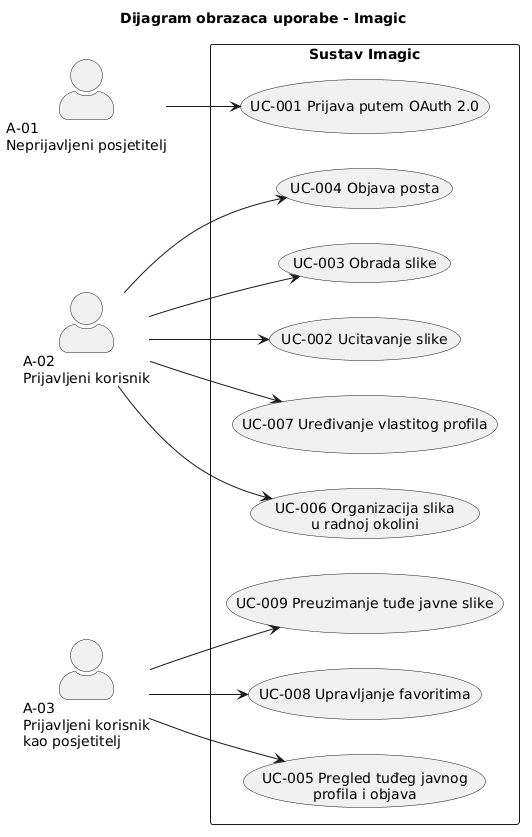

# 3. Obrasci uporabe

**Cilj:** Prikazati glavne interakcije između aktera aplikacije i sustava. Opisati kako akter ostvaruje cilj i što se događa kada važan korak ne uspije.

## 3.1 Dijagram obrazaca uporabe

**Cilj:** Prikazati granicu sustava, relevantne aktere i njihove glavne ciljeve u preglednom UML dijagramu obrazaca uporabe.

**PlantUML izvor:** [obrasci-uporabe.puml](obrasci-uporabe.puml)

Primarni akteri (A-01, A-02) nalaze se lijevo, a vanjski sustavi s kojima Imagic komunicira (Auth0, Artic API) desno. Veza `<<include>>` označava ponašanje koje se uvijek izvodi kao dio osnovnog obrasca. UC-010 Spremanje slike u radnu okolinu zajednički je korak obrazaca UC-002, UC-003 i UC-011. Veza `<<extend>>` označava neobavezno ponašanje koje korisnik može pokrenuti iz osnovnog obrasca. Tako se iz pregleda tuđeg javnog profila (UC-005) profil ili post može dodati u favorite (UC-008), a slika iz javnog posta preuzeti (UC-009).

## 3.2 Specifikacije obrazaca uporabe

**Cilj:** Povezati obrasce uporabe iz dijagrama s akterima i funkcijskim zahtjevima.

Akteri su opisani u [2.3 Dionici i akteri](2-Analiza-zahtjeva.md#23-dionici-i-akteri), a veze sa zahtjevima navedene su u [2.6 Sljedivost zahtjeva](2-Analiza-zahtjeva.md#26-sljedivost-zahtjeva).

| ID | Naziv | Akter | Povezani zahtjevi |
|----|-------|-------|-------------------|
| UC-001 | Prijava putem OAuth 2.0 | A-01 Neprijavljeni posjetitelj | F-001 |
| UC-002 | Učitavanje slike | A-02 Prijavljeni korisnik | F-002, F-016 |
| UC-003 | Obrada slike | A-02 Prijavljeni korisnik | F-005 – F-009, F-016 |
| UC-004 | Objava posta | A-02 Prijavljeni korisnik | F-011 – F-012 |
| UC-005 | Pregled tuđeg javnog profila i objava | A-02 Prijavljeni korisnik | F-013 |
| UC-006 | Organizacija slika u radnoj okolini | A-02 Prijavljeni korisnik | F-002 – F-004, F-016 |
| UC-007 | Uređivanje vlastitog profila | A-02 Prijavljeni korisnik | F-010 |
| UC-008 | Upravljanje favoritima | A-02 Prijavljeni korisnik | F-014 |
| UC-009 | Preuzimanje tuđe javne slike | A-02 Prijavljeni korisnik | F-015 |
| UC-010 | Spremanje slike u radnu okolinu | — (uključuju ga UC-002, UC-003, UC-011) | F-002, F-009, F-016 |
| UC-011 | Dodavanje djela iz Artic galerije | A-02 Prijavljeni korisnik; S-02 Artic API | F-017 |

## 3.3 Opisi obrazaca uporabe

### UC-001 Prijava putem OAuth 2.0

**Akter:** A-01 Neprijavljeni posjetitelj; vanjski sustav S-01 Auth0

**Preduvjeti**

- Korisnik je otvorio aplikaciju Imagic i nije prijavljen.

**Glavni tijek**

1. Korisnik odabire opciju „Prijava”.
2. Sustav preusmjerava korisnika na Auth0 stranicu za prijavu.
3. Korisnik unosi podatke za prijavu ili odabire prijavu putem Google računa.
4. Auth0 provjerava identitet korisnika i preusmjerava ga natrag u aplikaciju Imagic.
5. Aplikacija dohvaća pristupni token i šalje ga poslužitelju radi provjere.
6. Poslužitelj provjerava valjanost tokena i traži korisnika u bazi podataka.
7. Ako se korisnik prijavljuje prvi put, sustav stvara korisnički zapis i dodjeljuje mu tri početne slike.
8. Sustav prikazuje korisnikovu radnu okolinu.

**Alternativni tijekovi**

- **A1 – Korisnik odustaje od prijave.** Korisnik prekida postupak na Auth0 stranici i ostaje neprijavljen.
- **A2 – Auth0 nije dostupan.** Sustav ne može dovršiti prijavu i korisnik ostaje neprijavljen.
- **A3 – Korisnički račun već postoji.** Sustav koristi postojeći korisnički zapis i otvara korisnikovu radnu okolinu.

**Postuvjeti**

- Nakon uspješne prijave korisnik može pristupiti svojoj privatnoj radnoj okolini i stranici profila.
- Nakon prve uspješne prijave korisniku su dostupne tri početne slike.
- Ako prijava ne uspije ili korisnik odustane, zaštićene funkcionalnosti ostaju nedostupne.

### UC-002 Učitavanje slike

**Akter:** A-02 Prijavljeni korisnik

**Preduvjeti**

- Korisnik je prijavljen i otvorio je svoju privatnu radnu okolinu.

**Glavni tijek**

1. Korisnik odabire opciju za učitavanje slike.
2. Korisnik odabire datoteku sa svojeg uređaja i potvrđuje učitavanje.
3. Sustav provjerava format i veličinu datoteke.
4. Sustav pohranjuje sliku u korisnikovu privatnu radnu okolinu (uključuje UC-010).
5. Sustav prikazuje učitanu sliku u popisu datoteka.

**Alternativni tijekovi**

- **A1 – Korisnik odustaje od učitavanja.** Korisnik zatvara dijalog prije potvrde učitavanja.
- **A2 – Format nije podržan ili datoteka prelazi dopuštenu veličinu.** Sustav odbija učitavanje i prikazuje razlog odbijanja.

**Postuvjeti**

- Nakon uspješnog učitavanja slika je dostupna vlasniku u njegovoj privatnoj radnoj okolini.
- U slučaju odustajanja ili odbijanja datoteka se ne pohranjuje.

### UC-003 Obrada slike

**Akter:** A-02 Prijavljeni korisnik

**Preduvjeti**

- Korisnik je prijavljen i odabrao je sliku u svojoj privatnoj radnoj okolini.

**Glavni tijek**

1. Korisnik odabire postupak obrade slike, primjerice filtar, morfološki operator, geometrijsku transformaciju ili segmentaciju.
2. Korisnik prema potrebi zadaje parametre odabranog postupka.
3. Sustav primjenjuje postupak i prikazuje rezultat obrade.
4. Korisnik prema potrebi nastavlja obradu ponavljanjem koraka od 1 do 3.
5. Korisnik odabire spremanje rezultata kao nove datoteke i unosi njezin naziv.
6. Sustav pohranjuje rezultat kao novu datoteku u korisnikovoj radnoj okolini (uključuje UC-010).

**Alternativni tijekovi**

- **A1 – Prepisivanje izvorne slike.** U 5. koraku korisnik odabire prepisivanje izvorne slike. Sustav sprema rezultat obrade umjesto izvorne slike.
- **A2 – Odustajanje od spremanja.** Korisnik završava obradu bez spremanja rezultata.
- **A3 – Poništavanje zadnjeg postupka.** Prije spremanja korisnik poništava zadnji primijenjeni postupak. Sustav prikazuje rezultat bez njega; nakon poništavanja prvog postupka prikazuje izvornu sliku.

**Postuvjeti**

- Nakon spremanja u novu datoteku u radnoj okolini postoje izvorna slika i rezultat obrade.
- Nakon prepisivanja izvorna datoteka zamijenjena je rezultatom obrade.
- Ako korisnik odustane od spremanja, pohranjena izvorna datoteka ostaje nepromijenjena.

### UC-004 Objava posta

**Akter:** A-02 Prijavljeni korisnik

**Preduvjeti**

- Korisnik je prijavljen i otvorio je stranicu vlastitog profila.
- Za novi post korisnik ima barem jednu sliku u svojoj radnoj okolini.

**Glavni tijek**

1. Korisnik odabire opciju za dodavanje novog posta.
2. Korisnik odabire sliku iz svoje radne okoline i unosi opis.
3. Korisnik određuje vidljivost posta. Početna postavka je „Privatno”.
4. Korisnik potvrđuje objavu.
5. Sustav sprema post i prikazuje ga na stranici korisnikova profila.

**Alternativni tijekovi**

- **A1 – Korisnik odustaje od objave.** Korisnik zatvara obrazac prije potvrde i sustav ne stvara post.
- **A2 – Uređivanje postojećeg posta.** Korisnik odabire vlastiti post, mijenja njegov sadržaj ili vidljivost i potvrđuje promjene. Sustav sprema promjene i prikazuje ažurirani post.
- **A3 – Brisanje postojećeg posta.** Korisnik odabire brisanje vlastitog posta. Sustav briše post i uklanja ga sa stranice profila.

**Postuvjeti**

- Javni post dostupan je prijavljenim korisnicima, a privatni post samo vlasniku.
- Nakon uređivanja prikazuje se spremljeni sadržaj uz odabranu vidljivost.
- Nakon brisanja post više nije dostupan.

### UC-005 Pregled tuđeg javnog profila i objava

**Akter:** A-02 Prijavljeni korisnik

**Preduvjeti**

- Korisnik je prijavljen u aplikaciju Imagic.

**Glavni tijek**

1. Korisnik otvara javnu stranicu drugog korisnika.
2. Sustav dohvaća javne podatke profila i javne postove vlasnika stranice.
3. Sustav prikazuje korisničko ime, profilnu sliku, kratki opis i popis javnih postova.
4. Korisnik pregledava prikazani sadržaj.

**Alternativni tijekovi**

- **A1 – Profil nema javnih postova.** Sustav prikazuje javne podatke profila i prazan popis postova.
- **A2 – Profil nije dostupan.** Sustav obavještava korisnika da traženi profil nije dostupan.

**Postuvjeti**

- Prikazani su dostupni javni podaci profila i javni postovi.
- Privatni postovi vidljivi su samo vlasniku profila.

### UC-006 Organizacija slika u radnoj okolini

**Akter:** A-02 Prijavljeni korisnik

**Preduvjeti**

- Korisnik je prijavljen i otvorio je svoju privatnu radnu okolinu.
- Za radnju nad postojećom slikom ili mapom korisnik ima odgovarajuću stavku u radnoj okolini.

**Glavni tijek**

1. Korisnik odabire mjesto u radnoj okolini na kojem želi stvoriti mapu.
2. Korisnik odabire opciju za stvaranje mape, upisuje naziv i potvrđuje unos.
3. Sustav stvara mapu na odabranom mjestu i ažurira prikaz radne okoline.
4. Korisnik odabire sliku koju želi organizirati i pokreće premještanje.
5. Korisnik odabire odredišnu mapu i potvrđuje premještanje.
6. Sustav sprema novi položaj slike i prikazuje je u odredišnoj mapi.

**Alternativni tijekovi**

- **A1 – Stvaranje podmape.** U 1. koraku korisnik otvara postojeću mapu. Sustav stvara novu mapu unutar nje.
- **A2 – Preimenovanje datoteke ili mape.** Korisnik odabire stavku, unosi novi naziv i potvrđuje promjenu. Sustav sprema naziv i ažurira prikaz.
- **A3 – Brisanje mape.** Korisnik odabire mapu i potvrđuje brisanje. Sustav provodi brisanje i ažurira prikaz.
- **A4 – Pregled slike.** Korisnik otvara odabranu sliku, a sustav je prikazuje u pregledniku slike.
- **A5 – Preuzimanje vlastite slike.** Korisnik odabire sliku i opciju za preuzimanje. Sustav omogućuje preuzimanje slike na korisnikov uređaj u podržanom formatu.
- **A6 – Odustajanje od radnje.** Korisnik zatvara dijalog prije potvrde. Sustav ne sprema promjenu za tu radnju.

**Postuvjeti**

- Spremljena struktura mapa, nazivi i položaji slika vidljivi su pri sljedećem otvaranju radne okoline.
- Nakon uspješnog preuzimanja korisnik ima lokalnu kopiju slike.

### UC-007 Uređivanje vlastitog profila

**Akter:** A-02 Prijavljeni korisnik

**Preduvjeti**

- Korisnik je prijavljen i otvorio je stranicu vlastitog profila.

**Glavni tijek**

1. Korisnik odabire opciju „Uredi profil”.
2. Sustav prikazuje obrazac s trenutačnim podacima profila.
3. Korisnik mijenja jedan ili više podataka, primjerice korisničko ime, ime za prikaz, profilnu sliku ili kratki opis.
4. Korisnik potvrđuje spremanje.
5. Sustav provjerava podatke i sprema izmjene.
6. Sustav prikazuje ažurirane podatke na stranici profila.

**Alternativni tijekovi**

- **A1 – Korisničko ime je zauzeto.** Sustav prikazuje poruku uz polje korisničkog imena. Korisnik može unijeti drugo ime i ponovno potvrditi spremanje.
- **A2 – Korisnik odustaje od uređivanja.** Korisnik zatvara obrazac prije spremanja i sustav prikazuje prethodno spremljene podatke.

**Postuvjeti**

- Uspješno spremljeni podaci prikazuju se na javnoj stranici profila.
- Podatke profila može uređivati samo njegov vlasnik.

### UC-008 Upravljanje favoritima

**Akter:** A-02 Prijavljeni korisnik

**Odnos:** proširuje (`<<extend>>`) UC-005. Korisnik dodavanje u favorite može pokrenuti tijekom pregleda tuđeg javnog profila ili posta (UC-005, korak 4). Popisu favorita može pristupiti i izravno.

**Preduvjeti**

- Korisnik je prijavljen.
- Za dodavanje je dostupan javni profil drugog korisnika ili njegov javni post.
- Za uklanjanje korisnik ima stavku na popisu favorita.

**Glavni tijek**

1. Korisnik otvara javni profil drugog korisnika ili njegov javni post.
2. Korisnik odabire opciju za dodavanje profila ili posta u favorite.
3. Sustav sprema odabranu stavku na korisnikov popis favorita.
4. Korisnik otvara popis favorita i na njemu vidi spremljenu stavku.

**Alternativni tijekovi**

- **A1 – Uklanjanje iz favorita.** Korisnik odabire spremljeni profil ili post i pokreće uklanjanje iz favorita. Sustav uklanja stavku i ažurira popis.
- **A2 – Sadržaj više nije javan ili je uklonjen.** Ako odabrani sadržaj više nije dostupan kada korisnik zatraži dodavanje, sustav odbija zahtjev i prikazuje obavijest.

**Postuvjeti**

- Nakon uspješnog dodavanja stavka se nalazi na korisnikovu popisu favorita.
- Nakon uspješnog uklanjanja stavka više nije na popisu favorita.

### UC-009 Preuzimanje tuđe javne slike

**Akter:** A-02 Prijavljeni korisnik

**Odnos:** proširuje (`<<extend>>`) UC-005. Korisnik preuzimanje pokreće tijekom pregleda tuđeg javnog posta koji sadrži sliku (UC-005, korak 4). Alternativni tijek A1 sprema kopiju u radnu okolinu, ali nije dio glavnog tijeka, pa obrazac ne uključuje UC-010.

**Preduvjeti**

- Korisnik je prijavljen.
- Korisnik je otvorio javni post drugog korisnika koji sadrži sliku.

**Glavni tijek**

1. Korisnik odabire opciju za preuzimanje slike iz javnog posta.
2. Sustav provjerava je li post još uvijek javan i je li slika dostupna.
3. Sustav šalje datoteku pregledniku radi preuzimanja.
4. Korisnik sprema datoteku na svoj uređaj.

**Alternativni tijekovi**

- **A1 – Dodavanje u vlastitu radnu okolinu.** U 1. koraku korisnik odabire dodavanje slike u svoju radnu okolinu. Nakon provjere dostupnosti sustav pohranjuje kopiju slike i prikazuje je u korisnikovu popisu datoteka.
- **A2 – Slika više nije dostupna.** Ako je post u međuvremenu obrisan, postao privatan ili slika nije dostupna, sustav odbija zahtjev i obavještava korisnika.

**Postuvjeti**

- Nakon uspješnog preuzimanja korisnik ima lokalnu kopiju slike.
- Nakon uspješnog dodavanja u radnu okolinu korisnik ima kopiju slike u svojoj privatnoj radnoj okolini.

### UC-010 Spremanje slike u radnu okolinu

**Akter:** nema izravnog aktera. Obrazac je uključen (`<<include>>`) u UC-002 Učitavanje slike, UC-003 Obrada slike i UC-011 Dodavanje djela iz Artic galerije.

**Preduvjeti**

- Korisnik je prijavljen.
- Osnovni obrazac predao je sadržaj slike, njezin naziv i odredišnu mapu u korisnikovoj radnoj okolini.

**Glavni tijek**

1. Sustav provjerava pripada li odredišna mapa prijavljenom korisniku.
2. Sustav provjerava format slike prema stvarnom sadržaju datoteke i njezinu veličinu.
3. Sustav sprema datoteku na disk poslužitelja i u bazi bilježi njezin naziv, format, veličinu i mapu.
4. Sustav vraća podatke o spremljenoj slici osnovnom obrascu.

**Alternativni tijekovi**

- **A1 – Format nije podržan ili datoteka prelazi dopuštenu veličinu.** Sustav ne sprema datoteku i osnovnom obrascu vraća razlog odbijanja.
- **A2 – Odredišna mapa ne pripada korisniku ili ne postoji.** Sustav odbija spremanje.

**Postuvjeti**

- Nakon uspješnog spremanja slika je vidljiva samo vlasniku u njegovoj radnoj okolini.
- Ako spremanje ne uspije, u radnoj okolini ne nastaje nova datoteka.

### UC-011 Dodavanje djela iz Artic galerije

**Akter:** A-02 Prijavljeni korisnik; vanjski sustav S-02 Artic API

**Preduvjeti**

- Korisnik je prijavljen i otvorio je stranicu Artic galerije.

**Glavni tijek**

1. Korisnik upisuje pojam za pretragu.
2. Sustav šalje upit Artic API-ju i prikazuje popis pronađenih djela iz javne domene s pregledom slike i nazivom djela.
3. Korisnik odabire djelo i opciju za dodavanje u radnu okolinu.
4. Sustav dohvaća sliku djela s Artic API-ja.
5. Sustav sprema sliku u korisnikovu radnu okolinu (uključuje UC-010).
6. Sustav obavještava korisnika da je djelo dodano.

**Alternativni tijekovi**

- **A1 – Nema rezultata.** Sustav prikazuje poruku da za zadani pojam nije pronađeno nijedno djelo.
- **A2 – Artic API nije dostupan.** Sustav prikazuje poruku da galerija trenutačno nije dostupna; radna okolina ostaje nepromijenjena.
- **A3 – Korisnik odustaje.** Korisnik napušta galeriju bez dodavanja djela.

**Postuvjeti**

- Nakon uspješnog dodavanja slika djela nalazi se u korisnikovoj privatnoj radnoj okolini.
- Ako dodavanje ne uspije ili korisnik odustane, radna okolina ostaje nepromijenjena.

## 3.4 Provjera dosljednosti obrazaca uporabe

**Cilj:** Provjeriti međusobnu usklađenost obrazaca uporabe, aktera, zahtjeva i ispitnih slučajeva. Cjelovito mapiranje održava se u [matrici sljedivosti zahtjeva](2-Analiza-zahtjeva.md#26-sljedivost-zahtjeva).

| Provjera | Pitanje za tim |
|----------|----------------|
| Zahtjev | Je li svaki važan obrazac uporabe povezan s postojećim zahtjevom? |
| Akter | Odgovara li akter naveden u obrascu utvrđenoj ulozi i dopuštenim interakcijama? |
| Dijagram | Podudaraju li se nazivi obrazaca i njihovi akteri u tablici, opisima i dijagramu? |
| Aplikacija | Može li tim demonstrirati opisani glavni tijek i važne alternative? |