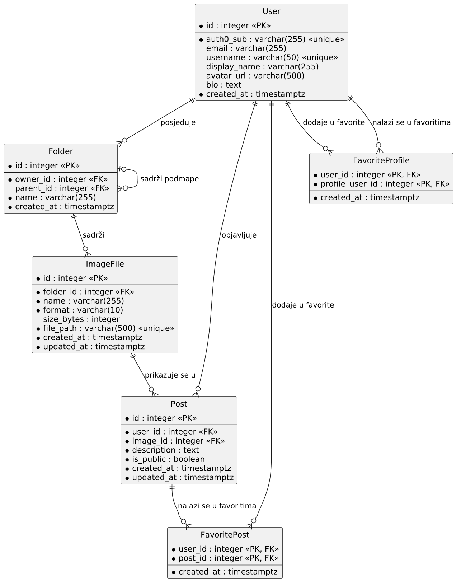
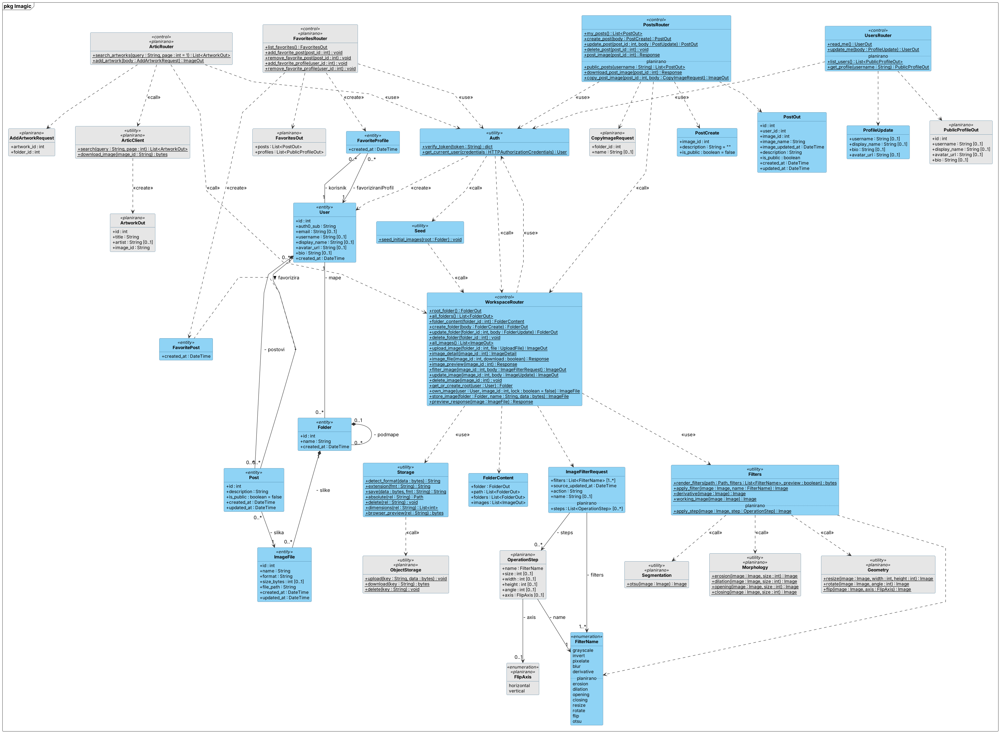

# 4. Arhitektura i oblikovanje

**Cilj:** Definirati arhitekturni stil, dekompoziciju programa na podsustave i module, organizaciju podataka te dinamičko ponašanje tijekom izvođenja. Arhitektura predstavlja temelj za implementaciju i ažurira se pri svakoj važnijoj promjeni projektnih odluka.

| Arhitekturni pogled | Ključno inženjersko pitanje | Primijenjeni model ili dijagram |
| :--- | :--- | :--- |
| **Strategija rješenja** | Koji stil i temeljne odluke određuju program? | Tablica odluka (odjeljak 4.1) |
| **Struktura podsustava** | Koji su glavni dijelovi i kako komuniciraju? | Dijagram komponenata (odjeljak 4.2) |
| **Model podataka** | Kako su strukturirani trajni podaci programa? | Relacijski ER dijagram (odjeljak 4.3.1) |
| **Struktura koda** | Kako su dodijeljene odgovornosti i ključne klase? | Reprezentativni dijagram razreda (odjeljak 4.3.2) |
| **Dinamičko ponašanje** | Kako moduli surađuju pri obradi ključnih transakcija? | Sekvencijski dijagram (odjeljak 4.4.1) |
| **Stanja sustava** | Kako ključni domenski objekt mijenja svoja stanja? | Dijagram stanja (odjeljak 4.4.2) |
| **Fizički razmještaj** | Na kojim se izvršnim čvorovima program izvodi? | Dijagram razmještaja ([poglavlje 6](6-Postavljanje-instalacija-i-konfiguracija.md#61-prikaz-razmještaja)) |

## 4.1 Ključne arhitekturne odluke

**Cilj:** Objasniti nekoliko arhitekturnih odluka koje najviše utječu na rješenje i navesti njihove projektno specifične razloge.

Imagic je jednostranična web-aplikacija (React SPA) koja s poslužiteljskim dijelom (FastAPI) komunicira preko REST API-ja. Poslužitelj provjerava identitet, pohranjuje podatke u PostgreSQL, a slike na disk.

```
React SPA  <--REST/JSON (/api/...)-->  FastAPI  <-->  PostgreSQL
    |                                     |
    +--> Auth0 (prijava, token)           +--> pohrana slika na disku (UPLOAD_DIR)
                                          +--> Auth0 (provjera tokena, /userinfo)
                                          +--> Artic API (3 početne slike; Artic galerija u izradi)
```

React SPA se prijavljuje preko Auth0 i uz svaki zahtjev backendu šalje pristupni token (`Authorization: Bearer`). Backend provjerava token Auth0 javnim ključevima, a pri prvoj prijavi dohvaća profil korisnika, stvara ga u bazi, stvara mu korijensku mapu i učitava 3 početne slike.

| Odluka | Razmatrana alternativa | Projektno specifično obrazloženje i kompromis |
| --- | --- | --- |
| Obrada slika na poslužitelju (Pillow/OpenCV) | Obrada u pregledniku (ImageJS) ili mješovito rješenje | Svi alati (filtri, morfologija, geometrija, segmentacija) imaju jednu implementaciju neovisnu o pregledniku, a poslužitelj ionako čita datoteke i podržava TIFF, koji preglednici ne prikazuju. Kompromis: svaka obrada je zahtjev prema poslužitelju, pa rezultat ovisi o brzini mreže i opterećuje poslužitelj (NF-04). |
| Prijava preko Auth0 (OAuth 2.0 / OpenID Connect) | Izravna integracija s pojedinim pružateljem identiteta (npr. Google) | Aplikacija ne pohranjuje lozinke (NF-01), a backend samo provjerava token izdan od Auth0 pomoću javnih ključeva (JWKS). Novi pružatelj dodaje se u Auth0 bez promjene koda. Kompromis: ovisnost o vanjskoj usluzi i potreba za upisom svake domene aplikacije u Auth0. |
| Relacijska baza (PostgreSQL) | Dokumentna baza (MongoDB) ili SQLite | Mape, slike, postovi i favoriti međusobno su povezani stranim ključevima; ograničenja jedinstvenosti i kaskadno brisanje (4.3.1) provodi sama baza, što bi se u dokumentnoj bazi moralo osiguravati u kodu. SQLite ne podržava istovremeni rad više korisnika na poslužitelju jednako pouzdano i ne nudi se kao upravljana usluga na Railwayu. Kompromis: svaka promjena sheme zahtijeva Alembic migraciju, a lokalni razvoj traži pokrenut PostgreSQL (Docker). |
| Slike na disku poslužitelja, u bazi samo putanja | Vanjska pohrana (S3-kompatibilna) | Dogovoreno s asistentom za prvu predaju: jednostavnije postavljanje bez dodatne usluge. Pristup datotekama prolazi samo kroz `backend/app/storage.py`, pa je kasniji prelazak ograničen na taj modul. Kompromis: disk mora biti trajan (Railway volume), a aplikacija se ne može horizontalno skalirati na više instanci. |
| Frontend pristupa podacima samo kroz `frontend/src/data/` | Komponente izravno pozivaju API | Komponente ne znaju za `fetch`, pristupni token ni rute backenda, nego koriste funkcije iz `useData()`; promjena API-ja ili izvora podataka mijenja samo podatkovni sloj, ne komponente. Kompromis: dodatni sloj apstrakcije. |
| Frontend i backend postavljeni kao jedan servis (FastAPI poslužuje i izgrađeni React) | Zasebno postavljanje frontenda (statički hosting) i backenda | Ista domena uklanja potrebu za CORS-om i pojednostavljuje Auth0 postavke (jedan URL); jedan Docker image i jedno postavljanje. Kompromis: frontend i backend uvijek se postavljaju zajedno. Detalji u [6.3](6-Postavljanje-instalacija-i-konfiguracija.md#63-javno-postavljanje-i-administracija). |

## 4.2 Gradivni blokovi i UML dijagram komponenata

**Cilj:** Prikazati logičku podjelu programa na komponente, njihova sučelja i vanjske integracije. Dijagram komponenata prikazuje logičku organizaciju, dok dijagram razmještaja prikazuje fizičko izvođenje. Ovaj prikaz ažurirajte kako sustav poprima konačan oblik.

**Dijagram komponenata:** [Dopuniti.]  
**PlantUML izvor:** [Dopuniti.]

| Komponenta | Odgovornost | Razlog za ovu granicu |
| --- | --- | --- |
|  |  |  |

## 4.3 Model podataka i oblikovanje razreda

**Cilj:** Objasniti važne informacije koje aplikacija pohranjuje i jedno reprezentativno područje oblikovanja na razini razreda. Model podataka i UML dijagram razreda odgovaraju na različita pitanja; jedno ne zamjenjuje drugo.

### 4.3.1 ER dijagram i model podataka

**Cilj:** Prikazati važne pohranjene entitete, njihove identifikatore i veze te dovoljno atributa za razumijevanje podataka aplikacije.

**Izvor dijagrama:** [er-dijagram.puml](er-dijagram.puml)  
**Implementacija:** SQLAlchemy modeli u `backend/app/models.py`, migracije u `backend/alembic/versions/`.

Entiteti: `User`, `Folder` (parent_id), `ImageFile` (folder_id, naziv, format, putanja), `Post` (user_id, image_id, opis, is_public), `FavoritePost`, `FavoriteProfile`.

ER dijagram prikazuje entitete aplikacije, pripadajuće atribute i veze među njima.



Tumač oznaka: `*` ispred atributa označava obvezan atribut (`NOT NULL`), a atributi bez `*` smiju biti prazni. `PK` je primarni ključ, `FK` strani ključ, a `unique` jedinstvena vrijednost. Veze su prikazane crow's foot notacijom.

Napomena: Entiteti su u dijagramu imenovani u jednini, jednako kao klase u kodu (npr. `User`). U bazi podataka odgovarajuće tablice imaju naziv u množini (npr. `users`), a u tablici ispod navedeno je koja tablica odgovara kojem entitetu. Naziv `user` nije korišten za tablicu jer je to rezervirana riječ u PostgreSQL-u.

**Opis entiteta**

| Entitet | Tablica u bazi | Što pohranjuje | Zahtjevi |
|---|---|---|---|
| `User` | `users` | Korisnike koji se prijavljuju putem Auth0 (`auth0_sub`), stoga nema lozinki, i podatke koji se nalaze na njihovoj javnoj stranici: korisničko ime, ime za prikaz, sliku (`avatar_url`) i kratki opis (`bio`). | F-001, F-010 |
| `Folder` | `folders` | Mape radne okoline. Vlasnik mape je `owner_id`, a `parent_id` upućuje na nadmapu i omogućuje ugniježđene mape. Svaki korisnik ima jednu korijensku mapu (`parent_id` je prazan), koja se stvara pri prvoj prijavi. | F-003, F-016 |
| `ImageFile` | `image_files` | Podatke o rasterskim slikama u radnoj okolini: mapa u kojoj se slika nalazi, naziv, format, veličina, putanja do stvarne datoteke na disku te vrijeme stvaranja i zadnje izmjene. Sama slika nije u bazi. Vlasnik slike određuje se preko njezine mape. | F-002, F-003, F-004, F-009, F-015, F-016 |
| `Post` | `posts` | Objave na javnoj stranici: autor, slika, tekstualni opis, oznaka je li objava javna ili privatna (`is_public`) te vrijeme stvaranja i zadnje izmjene. | F-011, F-012, F-013, F-015 |
| `FavoritePost` | `favorite_posts` | Objave koje je korisnik dodao u favorite. Par (`user_id`, `post_id`) je primarni ključ, pa se ista objava ne može dodati dvaput. | F-014 |
| `FavoriteProfile` | `favorite_profiles` | Javne stranice drugih korisnika koje je korisnik dodao u favorite. `user_id` je korisnik koji dodaje, a `profile_user_id` vlasnik stranice. | F-014 |

**Veze**

| Veza | Kardinalnost | Atribut |
|---|---|---|
| `User` posjeduje `Folder` | 1 : N | `Folder.owner_id` |
| `Folder` sadrži podmape | 1 : N, nadmapa je prazna samo kod korijenske mape | `Folder.parent_id` |
| `Folder` sadrži `ImageFile` | 1 : N, svaka slika je u točno jednoj mapi | `ImageFile.folder_id` |
| `User` objavljuje `Post` | 1 : N | `Post.user_id` |
| `ImageFile` prikazuje se u `Post` | 1 : N | `Post.image_id` |
| `User` dodaje u favorite `Post` | N : M | entitet `FavoritePost` (tablica `favorite_posts`) |
| `User` dodaje u favorite `User` (stranicu) | N : M | entitet `FavoriteProfile` (tablica `favorite_profiles`) |

**Odluke o modelu**

| Pitanje | Odluka | Razlog |
|---|---|---|
| Što se događa s objavom kad se njezina slika obriše iz radne okoline? | Sučelje prije brisanja traži potvrdu i upozorava da će se obrisati i objave koje koriste sliku. Nakon potvrde backend briše sliku, a baza objave koje je koriste (`ON DELETE CASCADE`). | Objava bez slike nema smisla (F-011), a zaštita od slučajnog gubitka objave nalazi se u sučelju. |
| Briše li brisanje mape i njezin sadržaj? | Da. Brišu se podmape i zapisi datoteka u njima (`ON DELETE CASCADE`). Backend briše i stvarne datoteke. Korisnik ne može obrisati svoju korijensku mapu. | Baza briše samo zapise, a ne datoteke na disku. |
| Smiju li dvije datoteke (ili mape) u istoj mapi imati isto ime? | Ne. Za slike je jedinstvena kombinacija (`folder_id`, `name`), a za mape (`owner_id`, `parent_id`, `name`). | Imenovanje i preimenovanje (F-003) ima smisla samo ako je ime u mapi jednoznačno. Kod slika nema problema s praznim vrijednostima jer je `folder_id` obvezan. Korijenske mape (`parent_id` je prazan) pokriva poseban indeks koji dopušta samo jednu korijensku mapu po korisniku. |
| Zašto slika nema vlastitog vlasnika? | Vlasnik slike je vlasnik njezine mape (`Folder.owner_id`). | Vlasništvo je zapisano na jednom mjestu, pa ne može doći do nepodudaranja. Provjera vlasništva (F-016, NF-02) ide preko mape. |
| Kako ostali korisnici vide sliku objave ako je radna okolina privatna? | Slika objave dohvaća se preko objave (`GET /api/posts/{id}/image`): vlasnik je uvijek vidi, a ostali prijavljeni korisnici samo ako je objava javna. Rute radne okoline (`/api/images/...`) dostupne su samo vlasniku. | Objava upućuje na zapis `ImageFile` (`Post.image_id`), a ne na kopiju. |
| Što ako se izvorna slika prepiše? | Prepisana slika prikazuje se i u objavi. | Objava upućuje na isti zapis `ImageFile`. |
| Smije li ista slika biti u više objava? | Da (na `Post.image_id` nema ograničenja jedinstvenosti). | Zahtjevi to ne ograničavaju. |
| Što ako autor objavu postavi kao privatnu, a drugi je korisnik ima u favoritima? | Zapis favorita ostaje, ali se objava ne prikazuje dok je privatna. | Ako autor objavu opet učini javnom, vraća se među favorite. |
| Kako se bilježi izmjena? | `ImageFile` i `Post` imaju `updated_at`, koji se automatski postavlja pri svakoj izmjeni zapisa. | Prepisivanje izvorne slike (F-009) i uređivanje objave (F-011) mijenjaju postojeće zapise. |
| Postoje li tablice za lozinke ili sesije? | Ne. | Prijavu obavlja Auth0, a backend provjerava izdani token (NF-01). |

**Ograničenja koja dijagram ne prikazuje**

- `User`: `auth0_sub` je jedinstven; `username` je jedinstven (smije biti prazan).
- `Folder`: jedinstveno ime mape unutar roditelja; točno jedna korijenska mapa po korisniku; mapa nije sama sebi roditelj. Backend osigurava da roditeljska mapa pripada istom korisniku i sprječava premještanje mape u vlastitu podmapu.
- `ImageFile`: jedinstveno ime unutar mape; jedinstvena putanja datoteke. Format datoteke (`jpeg`, `png`, `tiff`, `webp`) provjerava backend prema sadržaju datoteke, ne baza. Ako u mapi već postoji slika istog imena, backend novoj slici dodaje sufiks.
- `Post`: `is_public` je zadano `false`; autor objave mora biti vlasnik slike (provjerava backend).
- `FavoritePost` i `FavoriteProfile`: složeni primarni ključ; korisnik ne može favorizirati sam sebe.

**Pravila brisanja**

- Brisanje korisnika briše njegove mape, slike, objave i favorite te zapise u kojima je on favorizirana stranica.
- Brisanje mape briše podmape i zapise slika u njoj.
- Brisanje slike briše objave koje je koriste (sučelje prije toga traži potvrdu).
- Brisanje objave uklanja je i iz favorita drugih korisnika.

### 4.3.2 Reprezentativni UML dijagram razreda

**Cilj:** Modelirati i prikazati razrede ili sučelja potrebna za dodjelu odgovornosti, operacija i veza u reprezentativnom dijelu sustava.

**Dijagram razreda:**



**PlantUML izvor:** [dijagram-razreda.puml](dijagram-razreda.puml)  
**Referenca na kod pri završnom pregledu:** `backend/app/models.py`, `backend/app/users.py`, `backend/app/posts.py`, `backend/app/workspace.py`, `backend/app/auth.py`, `backend/app/storage.py`, `backend/app/filters.py`, `backend/app/seed.py`

Entiteti (`<<entity>>`) su SQLAlchemy modeli, routeri (`<<control>>`) primaju HTTP zahtjeve i provjeravaju vlasništvo nad resursom, a servisi (`<<utility>>`) obavljaju prijavu (`Auth`), rad s datotekama (`Storage`), obradu slike (`Filters`) i stvaranje početnih slika (`Seed`). Od DTO-ova (Pydantic shema) prikazano je pet reprezentativnih, a ostali se pojavljuju samo kao tipovi u potpisima operacija. Radi preglednosti izostavljeni su parametri `user` i `db` i konstante.

Budući dio (nije još napravljen) označen je sa `<<planirano>>` te obojan sivom bojom:

| Planirano | Zahtjev / izvor | Obrazac uporabe |
|---|---|---|
| `Morphology`, `Geometry`, `Segmentation`, `FlipAxis`, `FilterName`, `OperationStep`, `steps` u `ImageFilterRequest`, `Filters.apply_step` | F-006 – F-008 | UC-003 |
| `UsersRouter.list_users`, `UsersRouter.get_profile`, `PostsRouter.public_posts`, `PublicProfileOut` | F-013 | UC-005 |
| `FavoritesRouter`, `FavoritesOut` (tablice `FavoritePost` i `FavoriteProfile` već postoje) | F-014 | UC-008 |
| `PostsRouter.download_post_image`, `PostsRouter.copy_post_image`, `CopyImageRequest` | F-015 | UC-009 |
| `ArticRouter`, `ArticClient`, `ArtworkOut`, `AddArtworkRequest` | F-017 | UC-011 |
| `ObjectStorage` (trenutno je pohrana slika na disku) | AS-04 | – |


Napominjem da strani ključevi nisu navedeni kao atributi nego su prikazani kao veze. 
Mapa–podmapa, mapa–slika i korisnik–post su kompozicije jer se primjenjuje `ON DELETE CASCADE`. 
Korisnik–mapa i post–slika su obična pridruživanja jer podmapa već pripada nadmapi, a post korisniku, a dio može pripadati samo jednoj cjelini. 
Smjer je strelicom označen samo na vezama s jasnim jednosmjernim pristupom. Na ostalim vezama nije označen jer, prema prezentaciji 6 sa predavanja: „izostanak strelice ne znači nužno obostranu navigabilnost". 


## 4.4 Ponašanje tijekom izvođenja

### 4.4.1 Reprezentativni UML sekvencijski dijagram

[Dopuniti.]

### 4.4.2 Reprezentativni UML dijagram stanja

[Dopuniti.]

## 4.5 Zapisi arhitekturnih odluka

[Dopuniti.]

## 4.6 Zajednička pravila oblikovanja (engl. Cross-cutting concerns)

[Dopuniti.]

## 4.7 Arhitekturni rizici i tehnički dug

[Dopuniti.]
