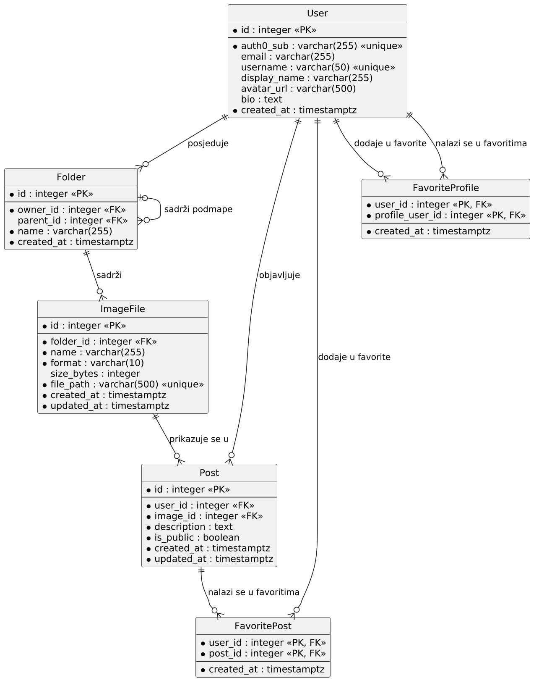

# 4. Arhitektura i oblikovanje

**Cilj:** Opisati glavne odluke oblikovanja, strukturu sustava, podatke i ponašanje.

## 4.1 Pregled arhitekture

```
React SPA  <--REST/JSON-->  FastAPI  <-->  PostgreSQL
                               |
                               +--> pohrana datoteka (slike)
                               +--> Auth0 (OAuth 2.0), Artic API
```

## 4.2 Odluke oblikovanja

| Odluka | Status | Razlog |
|--------|--------|--------|
| React + JavaScript (frontend) | Donesena | Odluka tima |
| FastAPI (backend) | Donesena | Odluka tima |
| Obrada slika na backendu (Pillow/OpenCV) | Donesena | Odluka tima (31.10.); jedna implementacija alata, neovisna o pregledniku |
| PostgreSQL (baza podataka) | Donesena | Odluka tima (31.10.); relacijski podaci (korisnici, mape, datoteke, postovi, favoriti) |
| Auth0 (OAuth 2.0) za prijavu | Donesena | Odluka tima (31.10.); aplikacija ne pohranjuje lozinke |

## 4.3 Model podataka (nacrt)

Entiteti: `User`, `Folder` (parent_id), `ImageFile` (folder_id, naziv, format, putanja), `Post` (user_id, image_id, tekst, is_public), `FavoritePost`, `FavoriteProfile`.

ER dijagram prikazuje entitete aplikacije, pripadajuće atribute i veze među njima. Izvor dijagrama (PlantUML) nalazi se u [er-dijagram.puml](er-dijagram.puml).



Tumač oznaka: `*` ispred atributa označava obvezan atribut (`NOT NULL`), a atributi bez `*` smiju biti prazni. `PK` je primarni ključ, `FK` strani ključ, a `unique` jedinstvena vrijednost. Veze su prikazane crow's foot notacijom.

Napomena: Entiteti su u dijagramu imenovani u jednini, jednako kao klase u kodu (npr. `User`). U bazi podataka odgovarajuće tablice imaju naziv u množini (npr. `users`), a u tablici ispod navedeno je koja tablica odgovara kojem entitetu. Naziv `user` nije korišten za tablicu jer je to rezervirana riječ u PostgreSQL-u.

**Opis entiteta**

| Entitet | Tablica u bazi | Što pohranjuje | Zahtjevi |
|---|---|---|---|
| `User` | `users` | Korisnike koji se prijavljuju putem Auth0 (`auth0_sub`), stoga nema lozinki, i podatke koji se nalaze na njihovoj javnoj stranici: korisničko ime, ime za prikaz, sliku (`avatar_url`) i kratki opis (`bio`). | F-001, F-010 |
| `Folder` | `folders` | Mape radne okoline. Vlasnik mape je `owner_id`, a `parent_id` upućuje na nadmapu i omogućuje ugniježđene mape. Svaki korisnik ima jednu korijensku mapu (`parent_id` je prazan), koja se stvara pri prvoj prijavi. | F-003, F-016 |
| `ImageFile` | `image_files` | Podatke o rasterskim slikama u radnoj okolini: mapa u kojoj se slika nalazi, naziv, format, veličina, putanja do stvarne datoteke na disku te vrijeme stvaranja i zadnje izmjene. Sama slika nije u bazi. Vlasnik slike određuje se preko njezine mape. | F-002, F-003, F-004, F-009, F-015, F-016 |
| `Post` | `posts` | Objave na javnoj stranici: autor, slika, tekstualni opis, oznaka je li objava javna ili privatna (`is_public`) te vrijeme stvaranja i zadnje izmjene. | F-011, F-012, F-013, F-015 |
| `FavoritePost` | `favorite_posts` | Objave koje je korisnik dodao u favorite. Par (`user_id`, `post_id`) je primarni ključ, pa se ista objava ne može dodati dvaput. | F-014 |
| `FavoriteProfile` | `favorite_profiles` | Javne stranice drugih korisnika koje je korisnik dodao u favorite. `user_id` je korisnik koji dodaje, a `profile_user_id` vlasnik stranice. | F-014 |

**Veze**

| Veza | Kardinalnost | Atribut |
|---|---|---|
| `User` posjeduje `Folder` | 1 : N | `Folder.owner_id` |
| `Folder` sadrži podmape | 1 : N, nadmapa je prazna samo kod korijenske mape | `Folder.parent_id` |
| `Folder` sadrži `ImageFile` | 1 : N, svaka slika je u točno jednoj mapi | `ImageFile.folder_id` |
| `User` objavljuje `Post` | 1 : N | `Post.user_id` |
| `ImageFile` prikazuje se u `Post` | 1 : N | `Post.image_id` |
| `User` dodaje u favorite `Post` | N : M | entitet `FavoritePost` (tablica `favorite_posts`) |
| `User` dodaje u favorite `User` (stranicu) | N : M | entitet `FavoriteProfile` (tablica `favorite_profiles`) |

**Odluke o modelu**

| Pitanje | Odluka | Razlog |
|---|---|---|
| Što se događa s objavom kad se njezina slika obriše iz radne okoline? | Backend prije brisanja provjerava koristi li sliku neka objava i traži potvrdu korisnika. Ako korisnik potvrdi, briše se slika i objave koje je koriste (`ON DELETE CASCADE`). | Objava bez slike nema smisla (F-011), a zaštita od slučajnog gubitka objave nalazi se u sučelju. |
| Briše li brisanje mape i njezin sadržaj? | Da. Brišu se podmape i zapisi datoteka u njima (`ON DELETE CASCADE`). Backend briše i stvarne datoteke. Korisnik ne može obrisati svoju korijensku mapu. | Baza briše samo zapise, a ne datoteke na disku. |
| Smiju li dvije datoteke (ili mape) u istoj mapi imati isto ime? | Ne. Za slike je jedinstvena kombinacija (`folder_id`, `name`), a za mape (`owner_id`, `parent_id`, `name`). | Imenovanje i preimenovanje (F-003) ima smisla samo ako je ime u mapi jednoznačno. Kod slika nema problema s praznim vrijednostima jer je `folder_id` obvezan. Korijenske mape (`parent_id` je prazan) pokriva poseban indeks koji dopušta samo jednu korijensku mapu po korisniku. |
| Zašto slika nema vlastitog vlasnika? | Vlasnik slike je vlasnik njezine mape (`Folder.owner_id`). | Vlasništvo je zapisano na jednom mjestu, pa ne može doći do nepodudaranja. Provjera vlasništva (F-016, NF-02) ide preko mape. |
| Kako ostali korisnici vide sliku objave ako je radna okolina privatna? | Backend dopušta dohvat slike svakom prijavljenom korisniku samo ako postoji javna objava koja tu sliku koristi. Sve ostale slike ostaju privatne. | Objava upućuje na zapis `ImageFile` (`Post.image_id`), a ne na kopiju. |
| Što ako se izvorna slika prepiše? | Prepisana slika prikazuje se i u objavi. | Objava upućuje na isti zapis `ImageFile`. |
| Smije li ista slika biti u više objava? | Da (na `Post.image_id` nema ograničenja jedinstvenosti). | Zahtjevi to ne ograničavaju. |
| Što ako autor objavu postavi kao privatnu, a drugi je korisnik ima u favoritima? | Zapis favorita ostaje, ali se objava ne prikazuje dok je privatna. | Ako autor objavu opet učini javnom, vraća se među favorite. |
| Kako se bilježi izmjena? | `ImageFile` i `Post` imaju `updated_at`, koji se postavlja pri svakoj izmjeni preko aplikacije. | Prepisivanje izvorne slike (F-009) i uređivanje objave (F-011) mijenjaju postojeće zapise. |
| Postoje li tablice za lozinke ili sesije? | Ne. | Prijavu obavlja Auth0, a backend provjerava izdani token (NF-01). |

**Ograničenja koja dijagram ne prikazuje**

- `User`: `auth0_sub` je jedinstven; `username` je jedinstven (smije biti prazan).
- `Folder`: jedinstveno ime mape unutar roditelja; točno jedna korijenska mapa po korisniku; mapa nije sama sebi roditelj. Backend osigurava da roditeljska mapa pripada istom korisniku i sprječava premještanje mape u vlastitu podmapu.
- `ImageFile`: jedinstveno ime unutar mape; jedinstvena putanja datoteke. Format datoteke provjerava backend, ne baza.
- `Post`: `is_public` je zadano `false`; autor objave mora biti vlasnik slike (provjerava backend).
- `FavoritePost` i `FavoriteProfile`: složeni primarni ključ; korisnik ne može favorizirati sam sebe.

**Pravila brisanja**

- Brisanje korisnika briše njegove mape, slike, objave i favorite te zapise u kojima je on favorizirana stranica.
- Brisanje mape briše podmape i zapise slika u njoj.
- Brisanje slike briše objave koje je koriste (backend prije toga traži potvrdu).
- Brisanje objave uklanja je i iz favorita drugih korisnika.
